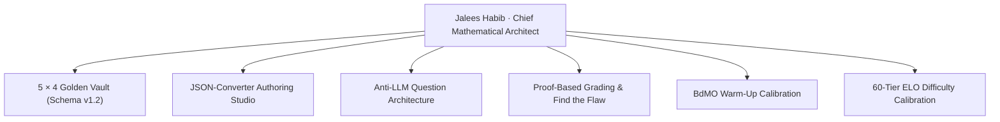
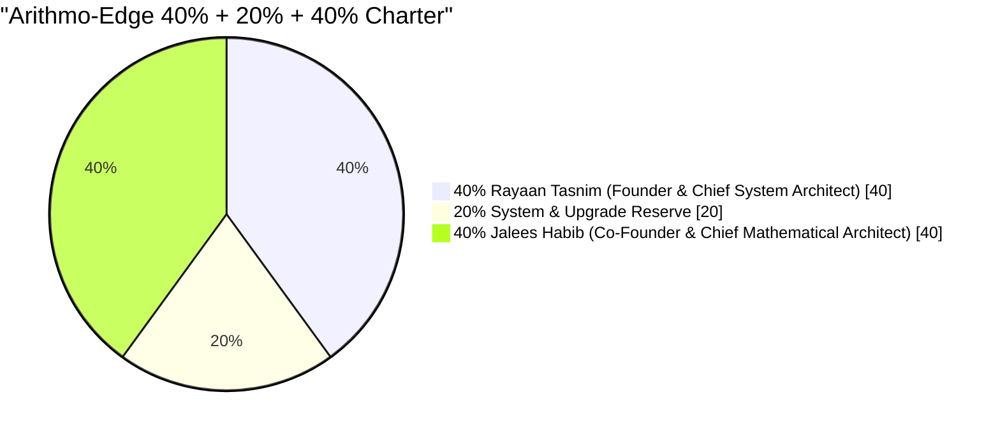
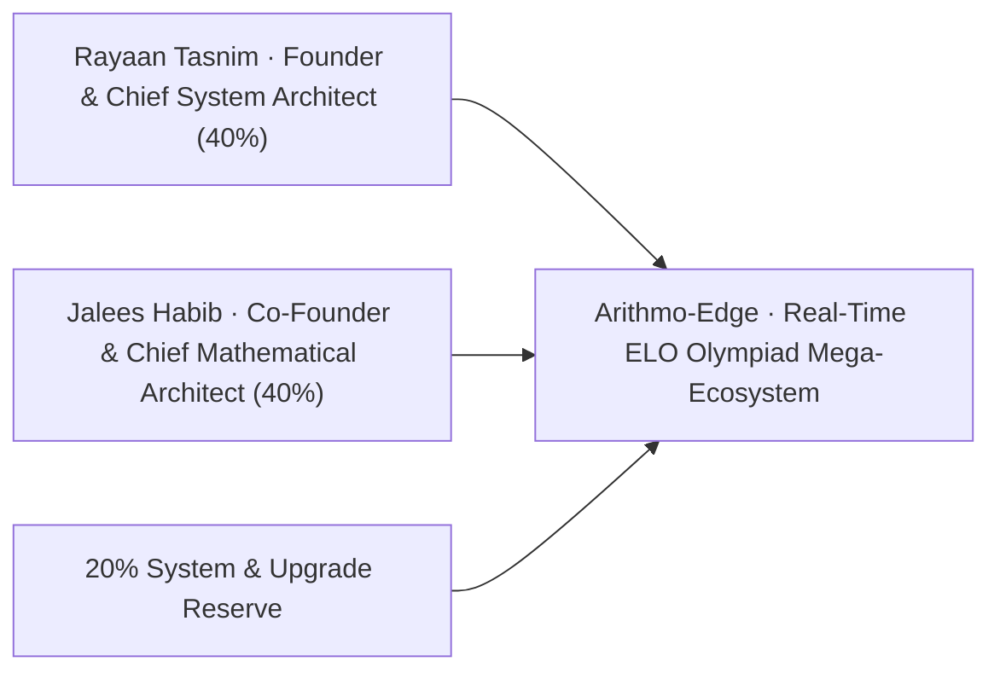

# Contributors — Arithmo-Edge Founding & Mathematical Charter

  

This repository documents the founding mathematical and systems architecture of **Arithmo-Edge** (*Powered by Olympiad Edge*), placing primary spotlight on **Jalees Habib** (**Co-Founder & Chief Mathematical Architect**) and his co-founding partnership with **Rayaan Tasnim** (**Founder & Chief System Architect**).

---

## Table of Contents

- [Executive Spotlight: Jalees Habib](#executive-spotlight-jalees-habib)
- [What Jalees Habib Built (6 Core Mathematical Pillars)](#what-jalees-habib-built-6-core-mathematical-pillars)
- [What Jalees Habib Receives in Return](#what-jalees-habib-receives-in-return)
- [Transparent 40% + 20% + 40% Equity & Governance Charter](#transparent-40--20--40-equity--governance-charter)
- [Co-Founder Synergy: System Engineering + Olympiad Mathematics](#co-founder-synergy-system-engineering--olympiad-mathematics)
- [Ecosystem Gateways & Official Links](#ecosystem-gateways--official-links)
- [Copyright & Attribution](#copyright--attribution)

---

## Executive Spotlight: Jalees Habib

**Jalees Habib** serves as **Co-Founder & Chief Mathematical Architect** of **Arithmo-Edge** (*Powered by Olympiad Edge*) . Working alongside **Rayaan Tasnim** (**Founder & Chief System Architect**), he anchors the mathematical rigor of real-time ELO competitive mathematics across the ecosystem.

| Charter Metric | Specification |
| :--- | :--- |
| **Reserved Executive Title** | **Chief Mathematical Architect** across Arithmo-Edge  |
| **Personal Equity Stake** | **40%** personal co-founder allocation alongside Rayaan Tasnim's **40%** personal allocation  |
| **HQ Command Standing** | **Prime Sovereign** tier across the 5-tier monotonic HQ ELO ladder (`100` to `1000`)  |
| **Governance & Stewardship** | Co-founding alignment spanning the 25-day decimal rollout (`V1.0–V4.0` culminating Dec 31, 2026 midnight) and 20-year holding horizon (`$1.5B–$3.0B` across `8` spin-off companies)  |

---

## What Jalees Habib Built (6 Core Mathematical Pillars)

1. **`5 × 4` Golden Question Bank (`Golden Vault`)** 
   - Co-authored and curated problem sets across the **5 Core Arenas** (*Number Theory, Algebra, Geometry, Combinatorics & Permutation, Mixed Mathematical Olympiad*) and **4 Expert Segments**.
   - Stored in `Schema v1.2` JSON format feeding the `5 × 4` Golden Vault .
2. **`JSON-Converter` Authoring Studio**
   - Supports structured mathematical problem authoring and JSON schema preparation for Arithmo-Edge problem sets .
3. **Anti-LLM Question Architecture**
   - Reinforces anti-brute-force mathematical design alongside Arithmo-Edge's hybrid symbolic and neural verification stack (`Gemini Pro/Flash + Qwen-Math + SymPy`).
4. **Proof-Based Grading & `Find the Flaw` Rubrics**
   - Aligns with proof-based grading, `2000+` ELO peer review, and post-contest **Find the Flaw** audits across the contest engine.
5. **Custom Warm-Up Championships (`BdMO` Calibration)**
   - Supports human-authored **BdMO** warm-ups across Primary through Higher Secondary tracks .
6. **60-Tier ELO Difficulty Calibration**
   - Calibrates difficulty progression across the **5 Core Arenas** and **60 Rank Tiers** (`0–499` through `3000+`) .

---

## What Jalees Habib Receives in Return

- **Reserved Title (`Chief Mathematical Architect`):** Recognized as **Co-Founder & Chief Mathematical Architect** across Arithmo-Edge governance and structured data records .
- **Equal `40%` Personal Co-Founder Equity:** Holds a **40%** founding allocation matching Rayaan Tasnim's **40%** founding allocation .
- **Supreme Governance (`Prime Sovereign`):** Participates in sovereign stewardship across the 5-tier monotonic HQ ELO ladder (`Core Sentinel 100` to `Prime Sovereign 1000`) and Honorary Prime Sovereign Council .
- **Long-Term Ecosystem Alignment:** Shares in the 20-year holding architecture (`$1.5B–$3.0B` across `8` spin-off companies) built on the `40% + 20% + 40%` charter .

---

## Transparent 40% + 20% + 40% Equity & Governance Charter

- **40% Rayaan Tasnim:** Founder & Chief System Architect allocation .
- **20% System & Upgrade Reserve:** Dedicated ring-fenced reserve supporting ongoing system and upgrade reliability .
- **40% Jalees Habib:** Co-Founder & Chief Mathematical Architect allocation .

---

## Co-Founder Synergy: System Engineering + Olympiad Mathematics

| Dimension | Rayaan Tasnim (`Founder & Chief System Architect`) | Jalees Habib (`Co-Founder & Chief Mathematical Architect`) |
| :--- | :--- | :--- |
| **Core Focus** | System architecture, 14-portal federation, `Arithmo-Core-SDK` (`engine.js`), 42-engine AI core, and `QPRT-4` / legal shield  | Mathematical architecture, `5 × 4` Golden Vault (`Schema v1.2`), Olympiad problem design, and contest / rating calibration |
| **Charter Share** | `40%` founding allocation  | `40%` founding allocation  |

---

## Ecosystem Gateways & Official Links

  <a href="https://rayaantasnim.github.io/Contributors/"><strong>Contributors Charter Page →</strong></a>  
  <a href="https://arithmo-edge.github.io/Introductory-Landing-Page/"><strong>Executive 3-Page Summary Gateway →</strong></a>  
  <a href="https://rayaantasnim.github.io/Arithmo-Edge/index.html"><strong>Main Ecosystem (01. Home Command Deck) →</strong></a>  
  <a href="https://rayaantasnim.github.io/Arithmo-Edge/why-arithmo.html"><strong>Why Arithmo-Edge? →</strong></a>  
  <a href="https://rayaantasnim.github.io/Arithmo-Edge/arenas-elo.html"><strong>5 Arenas & 60 ELO Tiers →</strong></a>  
  <a href="https://rayaantasnim.github.io/Arithmo-Edge/contests.html"><strong>Contest Engine & Find the Flaw →</strong></a>  
  <a href="https://rayaantasnim.github.io/Arithmo-Edge/ai-core.html"><strong>42-Engine AI Core →</strong></a>  
  <a href="https://rayaantasnim.github.io/Arithmo-Edge/socials-forge.html"><strong>Socials, Forge & Golden Vault →</strong></a>  
  <a href="https://rayaantasnim.github.io/Arithmo-Edge/governance.html"><strong>Headquarters & Patrons →</strong></a>  
  <a href="https://rayaantasnim.github.io/Arithmo-Edge/pioneers.html"><strong>Pioneer Contributors →</strong></a>  
  <a href="https://github.com/Arithmo-Edge"><strong>GitHub Organization →</strong></a>  
  <a href="https://www.linkedin.com/in/rayaan-tasnim/"><strong>LinkedIn (Rayaan Tasnim) →</strong></a>  
  <a href="mailto:rayaantasnim@gmail.com"><strong>Direct Email →</strong></a>

---

## Copyright & Attribution

Authorized by Rayaan Tasnim   
© All Rights Reserved   
© Arithmo-Edge 2026  
Powered by Olympiad Edge 